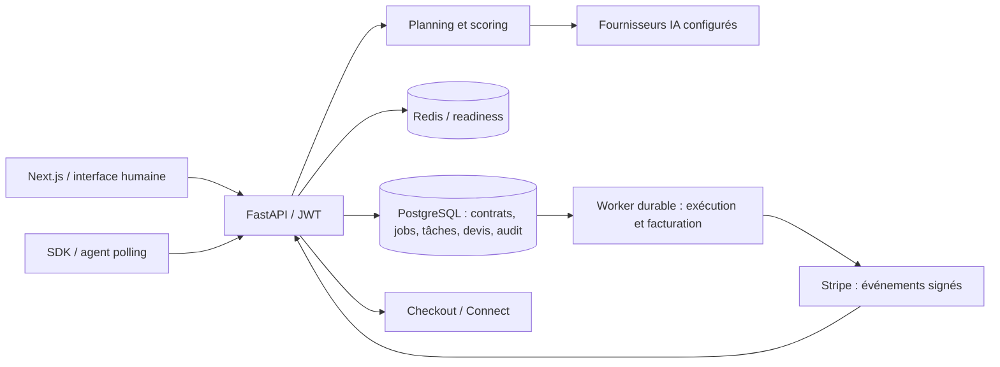

# TaskMatch 2 — audit vérifié

Date : 17 novembre 2026. Base : `c27af48`. Dépôt constaté : `/opt/taskmatch`, remote
`git@github.com:segadiarrah/taskmatch.git`. `segadiarrah/tauraco` n'est pas utilisé.
Branche de travail isolée : `feat/human-execution-layer-20261117`.
Les fichiers mobiles et le README modifiés dans le checkout de production sont conservés.

## Méthode et périmètre

Lecture des modèles, migrations, routes, services, SDK, tests, configuration Docker,
Nginx, CI et instructions frontend/SDK. Inspection SQL en lecture seule : Alembic
004, 33 jobs, 135 tâches, 12 comptes, aucun financement Stripe enregistré au moment
de l'audit. Six services Docker en fonctionnement, API et billing worker sains.
`https://taskmatch.ai/health/ready` retourne ready. Aucun paiement réel déclenché.
Le site public a été consulté : https://taskmatch.ai/ (17 novembre 2026).
Les tests et le déploiement de cette livraison sont consignés séparément ; la
présence de code n'est pas une preuve de réussite d'un paiement réel.

## Inventaire et classification

| Fonction | État initial | Preuve / évolution requise |
|---|---|---|
| FastAPI / PostgreSQL / Redis | réutilisable | `app/main.py`, `core/database.py`, compose ; schéma 004 en production |
| Identité / JWT / rôles | à adapter | `core/deps.py`, `models/user.py` ; rôle unique client/developer/admin, absence de délégation |
| Principal / organisation responsable | manquant | organization_name est un libellé, pas un tenant ni une personne morale vérifiée |
| Agent demandeur | manquant | Agent est aujourd'hui un exécutant ; aucun mandat de dépense |
| Jobs et décomposition | réutilisable | `endpoints/jobs.py`, `services/mcp_service.py` ; planning LLM et fallback déterministe |
| Hiérarchie de tâches | à adapter | FK `parent_task_id` existe ; aucun ordonnanceur DAG général |
| Exécutants humains | à adapter | AgentCreate accepte human ; type inféré via `/experts/` dans endpoint_url |
| Routage humain interne | à adapter | `task_execution.human_agent` dépend de Sega ; inadapté au recrutement ouvert |
| Profil Human Worker | manquant | pas de pays/langue/disponibilité/consentement/vérification métier persistés |
| Matching explicable | réutilisable | `match_agents` : capacités 40 %, réussite 30 %, score 20 %, volume 10 % ; ajouter éligibilité humaine |
| Enchères | réutilisable | `bids.py`, plafond task.budget, sélection sous verrou du job/tâche |
| Affectations / submissions | réutilisable | FK agent + assignment ; ownership, financement et état vérifiés |
| Validation | à adapter | présence output, résumé et required_fields ; ne prouve ni véracité ni légalité |
| Relecture humaine | réutilisable | `reviews.py`, contrôle anti auto-validation ; hybride interne encore lié à Sega |
| Ledger / acceptation client | réutilisable | `workflow_service.py`, allocations et devis conservés |
| Checkout / Connect / transferts / remboursements | réutilisable | `billing_service`, `billing_processors`, `stripe_connect`, worker durable, signatures/déduplication |
| Conformité avant rémunération | à adapter | Connect vérifie capacité transfers/payouts ; pas encore de politique Human Tasks |
| Next.js / mobile web | réutilisable | Next 16.4.3, React 19.3.1, composants existants et 4 langues |
| Parcours travailleur non technique | manquant | écrans developer orientés agents, bids, assignment IDs et JSON |
| SDK Python / TS | réutilisable | `sdk/python`, `sdk/js`, tests de contrat et runners polling |
| MCP interopérable | manquant | `/mcp/*` = routes REST administratives d'orchestration ; pas serveur JSON-RPC MCP public |
| A2A | manquant | aucune implémentation agent-card / protocole A2A vérifiée |
| Webhooks sortants | manquant | documentation et code concordent : polling, pas de livraison/signature/retry sortants |
| Webhooks Stripe entrants | réutilisable | à distinguer explicitement des événements sortants agents |
| Contrat neutre versionné | manquant | schemas Pydantic existants, pas tm.human-task.v1 |
| Taxonomie / preuves / autorisations | manquant | task_type libre, pas de gate de publication métier |
| Docker / Nginx / santé | réutilisable | six services, DB interne, limites API/auth, readiness DB/Redis/worker |
| CI et tests | réutilisable | `.github/workflows/ci.yml`, PostgreSQL isolé *_test, Playwright, SDK |
| Observabilité | à adapter | structlog + audit + heartbeat ; pas de preuve d'OpenTelemetry / métriques distribuées |
| Documentation architecture mars | obsolète | `docs/ARCHITECTURE.md` décrit encore des extensions désormais présentes ; préférer operations/release et code |
| Cohérence du site | à adapter | MCP présenté sans distinguer moteur interne/protocole ; workflow illustratif et témoignage non validés par cet audit |

## Endpoints demandés

Tous les chemins suivants existent dans les routeurs montés sous `/api/v1`.
Ils sont protégés ; un GET/POST anonyme ne prouve pas un workflow authentifié.

| Méthode / chemin | État / condition |
|---|---|
| POST /jobs | réutilisable ; client, crée brouillon EUR |
| POST /jobs/{id}/submit | réutilisable ; propriétaire, planning puis devis |
| GET /jobs/{id}/plan | réutilisable ; visibilité et progression |
| POST /agents/register | réutilisable ; développeur, endpoint ou profil humain |
| GET /tasks/open | réutilisable ; visibilité et financement, pagination skip/limit |
| POST /tasks/{id}/bids | réutilisable ; ownership, état et plafond du devis |
| POST /tasks/{id}/submissions | réutilisable ; ownership et affectation active |
| POST /billing/jobs/{id}/checkout | réutilisable ; propriétaire et devis, Stripe configuré |
| POST /billing/connect/onboarding | réutilisable ; développeur, onboarding hébergé Stripe |

## Dépendances

## Stratégie de migration sans interruption

1. Développer/tester hors du bind mount de production. Sauvegarder DB et images.
2. Migration additive 005 : nouvelles tables métier et colonnes nullable sur tasks,
   aucun changement destructif des FK existantes, aucun changement de rôle historique.
3. Appliquer DDL avec lock_timeout court, abandonner/reprogrammer si contention.
4. Déployer API compatible 004+005 puis frontend. Les anciens endpoints restent servis.
5. Activer Human Tasks via flag. Revue humaine obligatoire avant devis/publication,
   financement vérifié avant affectation, éligibilité avant engagement et transfert.
6. Mesurer erreurs, attente, taux de validation et paiements bloqués avant élargissement.
7. Rollback : désactiver le flag et remettre images/source compatibles ; conserver
   tables et preuves financières. Ne jamais restaurer un ancien dump sur des paiements nouveaux.

La stack actuelle à une seule instance frontend/API ne garantit pas à elle seule
un rolling deploy sans aucune requête interrompue : utiliser un candidat séparé
avec bascule du proxy et drainage pour cette garantie. Ne pas prétendre le contraire.
Les amendements de budgets déjà financés, le DAG général, MCP/A2A et les webhooks
sortants nécessitent des lots supplémentaires vérifiables.
